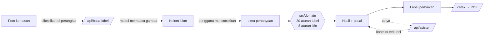

> **Menilai Tilik Label?** Buka [JURI.md](JURI.md) lebih dulu. Dalam tiga menit, panduan itu menunjukkan apa yang perlu dibuka, apa yang perlu diklik, dan hasil yang seharusnya muncul. Tidak perlu akun dan tidak perlu membawa kemasan.

<div align="center">


# Tilik Label

### Cek dulu, baru cetak.

Pemeriksa label kemasan untuk pembuat makanan rumahan. Pengguna memotret stiker kemasannya, Tilik Label membaca tulisannya, lalu **20 aturan label BPOM yang ditulis sebagai kode** menentukan apa yang sudah benar, apa yang kurang, dan pasal mana yang dilanggar. Hasilnya label perbaikan yang siap dicetak, sebelum uang keluar untuk seribu stiker yang salah.

<br>


<br>

### Tautan

| | |
|---|---|
| **Panduan untuk juri** | **[JURI.md](JURI.md)** |
| **Situs** (tanpa login, tidak perlu akun demo) | **[tilik-label.vercel.app](https://tilik-label.vercel.app)** |
| **Mode juri** (tiga kemasan contoh, tiap langkah bisa diisi sekali klik) | **[tilik-label.vercel.app/juri](https://tilik-label.vercel.app/juri)** |
| **Dokumen kebutuhan produk** | [docs/PRD.md](docs/PRD.md) |
| **Dokumentasi teknis** | [docs/](docs/README.md) |
| **Repositori** | [github.com/astrorehan/tilik-label](https://github.com/astrorehan/tilik-label) |

**[Masalah](#masalah)** ·
**[Yang dikerjakan](#yang-dikerjakan)** ·
**[Cara kerja](#cara-kerja)** ·
**[Aturan yang diperiksa](#aturan-yang-diperiksa)** ·
**[Teknologi](#teknologi-apa-dipakai-di-mana)** ·
**[Cek sendiri](#cek-sendiri)** ·
**[Jalankan di komputer sendiri](#jalankan-di-komputer-sendiri)** ·
**[Penggunaan AI](#penggunaan-ai-template-dan-aset)**

</div>

---

## Masalah

Pembuat keripik, sambal, dan kue kering pandai memasak, tetapi jarang membaca Peraturan BPOM tentang label. Padahal label diperiksa Dinas Kesehatan saat mengurus izin produksi rumah tangga (SPP-IRT), dan permohonan ditangguhkan bila data labelnya tidak lengkap (Peraturan BPOM 4/2024 Pasal 9, 14, dan 18). Kesalahannya sering baru ketahuan setelah stiker dicetak.

Tekanannya bertambah: sejak 17 Juni 2026, tabel nilai gizi wajib dicantumkan, termasuk untuk produk rumah tangga, dengan masa penyesuaian 24 bulan (Peraturan BPOM 10/2026 Pasal 2 dan 31). Di Kota Semarang, 16 dari 18 produk rumah tangga yang diteliti belum mencantumkan informasi nilai gizi ([USM Law Review, 2025](https://journals.usm.ac.id/index.php/julr/article/view/11794); satu kota, 18 sampel, bukan angka nasional).

Daftar keterangan wajib memang bisa dicari di internet. Yang tidak bisa dicari adalah **apakah label milik sendiri sudah benar**: urutan bahan yang harus cocok dengan resep, format kedaluwarsa yang bergantung pada umur simpan, kalimat alergen yang bunyinya ditetapkan, atau klaim "tanpa pengawet" yang bertentangan dengan komposisi. Bagian itu yang dikerjakan Tilik Label.

---

## Yang dikerjakan

| Fitur | Artinya bagi pengguna |
|---|---|
| **Foto atau unggah label** | Kamera HP atau laptop, unggah dari galeri, atau isi tanpa foto. Mutu foto (buram, gelap, terpotong) dicek di perangkat dan gambar dikecilkan sebelum dikirim. |
| **Pembaca foto** | Model bahasa yang bisa membaca gambar menyalin tulisan kemasan ke kolom isian. Keluarannya divalidasi skema; bila gagal, pengguna diarahkan mengisi sendiri. |
| **Pengguna mengesahkan hasil baca** | Semua kolom tampil dan bisa dibetulkan sebelum diperiksa. Aturan tidak pernah memeriksa tebakan model secara langsung. |
| **Lima pertanyaan singkat** | Umur simpan, cara simpan, sertifikat halal, alat produksi, dan resep. Bisa dijawab dengan teks atau suara. |
| **Pemeriksa 20 aturan label** | Tiap butir berstatus sesuai, kurang, atau tidak bisa dicek dari foto, dan menunjuk pasalnya. |
| **Jalur izin** | Tidak wajib SPP-IRT, bisa lewat SPP-IRT, atau tidak bisa lewat jalur itu, beserta alasan dan pasal. |
| **Label perbaikan** | Yang bisa dibetulkan langsung dibetulkan (awalan "Komposisi:", "Baik digunakan sebelum:", penulisan "P-IRT", kalimat alergen resmi). Yang butuh keputusan pemilik ditanyakan satu per satu. |
| **Siap cetak** | Label berskala fisik dengan huruf minimal 1 mm (2 mm untuk nama produk dan peringatan alergen), plus lembar ringkasan. Disimpan sebagai PDF lewat cetak peramban. Tombol cetak terkunci selama butir wajib masih kosong. |
| **Tanya Tilik** | Asisten yang menjelaskan temuan dalam bahasa sehari-hari, terkunci pada hasil pemeriksaan dan ringkasan pasal. Asisten tidak bisa mengubah status temuan. |
| **Produk saya** | Hasil tersimpan di peramban pengguna, tanpa akun dan tanpa server basis data. |
| **Panduan nilai gizi** | Tiga jalan resmi untuk usaha mikro menurut Peraturan BPOM 10/2026 Pasal 7. Tidak menampilkan angka gizi, karena tata cara hitung resminya belum terbaca langsung. |
| **Mode juri** | Tiga kemasan rekaan dengan kesalahan yang berbeda; tiap langkah bisa diisi sekali klik, dan hasilnya tetap muncul walau layanan model sedang tidak tersedia. |

---

## Prinsip

1. **AI membaca, aturan yang memutuskan.** Model hanya menyalin tulisan dari foto dan menjelaskan temuan. Lolos atau tidaknya tiap butir ditentukan fungsi aturan di `src/domain` yang tetap dan diuji.
2. **Setiap temuan menunjuk pasal.** Pengguna bisa memeriksa sendiri dasarnya di teks resmi.
3. **Yang tidak bisa dicek dikatakan tidak bisa dicek.** Contohnya ukuran huruf pada kemasan asli.
4. **Data izin tidak dikarang.** Nomor izin, keterangan halal, dan tanggal hanya berasal dari pengguna.
5. **Pemeriksaan awal, bukan pengesahan.** Keputusan tetap di Dinas Kesehatan atau BPOM, dan kalimat ini tampil di hasil dan di lembar cetak.

---

## Cara kerja



| Langkah | Yang terjadi | Di mana |
|---|---|---|
| 1. Foto | Mutu gambar dicek dan gambar dikecilkan ke sisi terpanjang 1600 px di peramban | `src/lib/image/` |
| 2. Baca | Server mengirim gambar ke DeepSeek V4.1 Flash. Jawaban divalidasi dengan skema JSON; bila gagal, pengguna diarahkan mengisi sendiri | `src/app/api/baca-label/`, `src/lib/server/labelReader.ts`, `src/domain/labelExtraction.ts` |
| 3. Cocokkan | Pengguna membetulkan isian. Draf tersimpan otomatis di perangkat | `src/components/periksa/`, `src/lib/periksaDraft.ts` |
| 4. Periksa | Fungsi murni tanpa jaringan menilai tiap aturan | `src/domain/labelRules.ts`, `src/domain/permitRules.ts` |
| 5. Perbaiki | Label perbaikan disusun dari isian dan jawaban, lalu diperiksa ulang tiap kali ada perubahan | `src/domain/correctedLabel.ts`, `src/domain/labelPrintScale.ts` |
| 6. Tanya | Asisten menerima hasil pemeriksaan sebagai konteks terkunci. Jawaban yang menyebut pasal atau peraturan di luar bahan acuan ditolak di server | `src/app/api/asisten/`, `src/domain/assistant.ts` |

Rincian arsitektur ada di [docs/arsitektur.md](docs/arsitektur.md).

---

## Aturan yang diperiksa

| Kelompok | Aturan | Jumlah |
|---|---|---|
| **Label** (`L-01`–`L-20`) | [Peraturan BPOM 31/2018](https://peraturan.go.id/files/bn1452-2018.pdf) tentang Label Pangan Olahan | 20 |
| **Jalur izin** (`I-01`–`I-08`) | [Peraturan BPOM 4/2024](https://peraturan.go.id/files/peraturan-bpom-no-4-tahun-2024.pdf) tentang pedoman SPP-IRT | 8 |
| **Nilai gizi** (`G-01`–`G-06`) | [Peraturan BPOM 10/2026](https://peraturan.go.id/files/peraturan-bpom-no-10-tahun-2026.pdf) tentang Informasi Nilai Gizi | panduan, tanpa angka |

Kira-kira tujuh aturan label soal ada atau tidaknya keterangan. Sebelas lainnya soal **cara penulisan dan kecocokan dengan resep atau jawaban pengguna**, misalnya:

| Butir | Yang diperiksa |
|---|---|
| `L-03` | Urutan bahan dari yang terbanyak, dicocokkan dengan takaran resep |
| `L-10` | Umur simpan sampai 3 bulan wajib memakai tanggal, bulan, dan tahun |
| `L-12` | Bahan alergen di komposisi wajib disertai kalimat alergen resmi |
| `L-16`, `L-17` | "Tanpa pengawet" dan "bebas bahan tambahan pangan" dibandingkan dengan komposisi |
| `I-05` | Klaim di label membuat produk tidak bisa lewat jalur SPP-IRT |

Daftar lengkap, pasal, cara cek, dan berkas kodenya ada di [docs/aturan.md](docs/aturan.md). Halaman `/aturan` di situs menampilkan daftar yang sama beserta hal yang tidak diperiksa. Teks aturan terakhir dibaca pada 12 November 2026.

---

## Teknologi: apa dipakai di mana

| Teknologi | Di mana | Dipakai untuk |
|---|---|---|
| **Next.js 16** (App Router), **React 19** | `src/app/` | Halaman, route server `/api/baca-label`, `/api/baca-resep`, `/api/asisten`, dan `/api/mcp`, halaman cetak |
| **TypeScript** mode ketat | seluruh repo | Tipe data label, jawaban, dan hasil aturan di `src/domain/types.ts` |
| **Tailwind CSS 4** | `src/app/globals.css`, `src/components/` | Token warna, tata letak 360–1440 px, mode cetak |
| **DeepSeek V4.1 Flash** (`deepseek-flash`) | `src/lib/server/labelReader.ts`, `src/lib/server/assistant.ts` | Satu-satunya model AI yang aktif di situs rilis: pembaca foto label, pembaca foto resep, dan asisten Tanya Tilik (mode non-thinking) |
| Claude Haiku 5.5 (`claude-haiku-5-5`), opsional | idem | Slot penyedia cadangan lewat `LLM_HAIKU_API_KEY` untuk percobaan dan pembanding. **Tidak diaktifkan di situs rilis** (kuncinya tidak diisi) |
| **Vitest 5** | `src/**/__tests__/`, `src/app/api/**/route.test.ts` | 715 tes unit untuk aturan, label perbaikan, pembaca foto, asisten, batas pemanggilan |
| **ESLint 9** | `eslint.config.mjs` | Pemeriksaan gaya dan aturan React |
| **GitHub Actions** | `.github/workflows/ci.yml` | Lint, tipe, tes, dan build di setiap PR dan push ke `main` |
| **Web Storage** | `src/lib/safeStorage.ts`, `src/lib/produkSaya.ts` | Draf pemeriksaan dan "Produk saya" di perangkat pengguna |
| **Web Speech API** | `src/components/periksa/ProductAnswerInput.tsx` | Menjawab pertanyaan dengan suara, bila peramban mendukung |

Tidak ada basis data, tidak ada akun, dan tidak ada penyimpanan foto di server.

---

## Pengaman layanan dan privasi

- **Kunci API hanya di server.** Peramban tidak pernah menerima kunci; semua panggilan model lewat route di `src/app/api/`.
- **Foto tidak disimpan.** Gambar diteruskan ke penyedia model untuk dibaca, lalu dibuang. Kalimat ini juga tampil di layar unggah.
- **Batas per pengunjung** (`src/lib/server/rateLimit.ts`). Bawaannya 10 pembacaan foto per jam dan 30 per hari per alamat IP, ditambah batas harian seluruh pengunjung yang terpisah untuk pembaca foto dan asisten. Permintaan peramban dari situs lain ditolak. Angkanya bisa diubah lewat `LLM_BATAS_*` (lihat `.env.example`).
- **Batas belanja di akun penyedia** sebagai pengaman terakhir: saldo secukupnya di akun DeepSeek.
- **Saat batas tercapai atau model gagal,** pengguna mendapat pesan beserta waktu tunggu dan tetap bisa mengisi label sendiri lalu mendapat hasil pemeriksaan penuh.

Penghitung batas memakai memori proses. Di platform serverless, tiap instans punya penghitung sendiri dan penghitung itu hilang saat instans dimulai ulang, jadi batas per pengunjung adalah rem pertama, bukan jaminan.

---

## Cek sendiri

Semua klaim di atas bisa dibuktikan dari repositori ini.

| Klaim | Cara mengecek |
|---|---|
| Aturan diputuskan kode, bukan model | `src/domain/` tidak mengimpor modul jaringan atau model; lihat `src/domain/labelRules.ts` |
| Seluruh aturan punya tes | `npm test` → 21 berkas, 715 tes lulus. Tes per aturan di `src/domain/__tests__/labelRules.test.ts` dan `labelRules.edge.test.ts` |
| Tiga contoh sengaja salah dengan cara berbeda | `src/domain/sampleLabels.ts` dan tesnya `src/domain/__tests__/sampleLabels.test.ts` |
| Asisten tidak bisa mengarang pasal | `findUnknownArticles` dan `findUnknownRegulations` di `src/domain/assistant.ts`, dipakai di `src/lib/server/assistant.ts` |
| Keluaran pembaca foto divalidasi | `validateExtraction` di `src/domain/labelExtraction.ts`, tes di `src/lib/__tests__/labelReader.test.ts` |
| CI menjaga `main` | Tab Actions di GitHub: lint, typecheck, tes, build |

---

## Yang sengaja tidak dikerjakan

Login dan akun, pendaftaran izin daring, pembayaran, toko daring, uji laboratorium, angka nilai gizi sebelum tata cara hitung resminya terbaca, pemeriksaan desain visual dan merek, aturan khusus minuman, pangan bayi, dan pangan keperluan khusus, serta jaminan lolos izin.

`I-08` (jenis pangan yang diizinkan di Lampiran I Peraturan BPOM 4/2024) belum diperiksa karena lampirannya belum terbaca langsung. Hasil jalur izin untuk butir ini ditulis "perlu dicek ke Dinas Kesehatan".

---

## Jalankan di komputer sendiri

Butuh Node.js 22 atau lebih baru.

```sh
git clone https://github.com/astrorehan/tilik-label.git
cd tilik-label
npm ci
cp .env.example .env.local   # isi LLM_DEEPSEEK_API_KEY
npm run dev                  # http://localhost:3000
```

Tanpa kunci API, semua halaman tetap jalan: mode juri memakai data contoh dan isian manual tetap diperiksa penuh. Yang tidak jalan hanya pembaca foto dan Tanya Tilik.

| Perintah | Fungsi |
|---|---|
| `npm test` | Seluruh tes unit |
| `npm run lint` | ESLint |
| `npm run typecheck` | Pemeriksaan tipe TypeScript |
| `npm run build` lalu `npm start` | Build dan jalankan versi produksi |
| `node scripts/bandingkan-pembaca.mjs` | Membandingkan ketepatan baca kedua penyedia pada label uji di `scripts/contoh-label/` (memanggil model berbayar) |

Panduan kerja tim (branch, pesan commit, batas modul) ada di [CONTRIBUTING.md](CONTRIBUTING.md).

---

## Struktur repositori

```
src/
  app/          halaman (/, /periksa, /juri, /contoh, /produk, /aturan, /nilai-gizi, /cetak) dan route API
  components/   antarmuka: alur periksa, hasil, asisten, cetak
  domain/       aturan label, izin, gizi, label perbaikan — fungsi murni beserta tesnya
  lib/          gambar, penyimpanan di perangkat, klien API, kode khusus server
public/         foto kemasan rekaan dan ilustrasi
scripts/        skrip pembanding pembaca foto dan label uji
docs/           PRD dan dokumentasi teknis
```

---

## Penggunaan AI, template, dan aset

Sesuai ketentuan IT RUSH 2026 (Guidebook bagian V butir 5), berikut semua AI, template, dan aset pihak lain yang dipakai.

| Yang dipakai | Peran | Batasannya |
|---|---|---|
| **DeepSeek V4.1 Flash** (API DeepSeek) | Komponen produk: membaca foto label dan foto resep ke kolom isian, serta menjelaskan temuan di Tanya Tilik | Lolos atau tidaknya label diputuskan aturan di `src/domain`, bukan oleh model. Keluaran divalidasi skema dan wajib dicocokkan pengguna. Asisten dikunci pada hasil pemeriksaan dan tidak bisa mengubah status temuan |
| **Claude** (Anthropic) | AI coding assistant untuk pengembangan: membantu menulis kode, merancang antarmuka (UI), *brainstorming* ide dan fitur, serta menyusun alur aplikasi | Bukan bagian dari produk. Setiap kode dan saran ditinjau, disesuaikan, dan diuji tim (lint, typecheck, tes unit, uji di peramban) sebelum digabung. Keputusan desain, alur, dan fitur tetap di tangan tim |

- Komponen antarmuka dasar (`src/components/ui`, ikon, dan token warna) diadaptasi dari proyek tim sebelumnya.
- Font [Atkinson Hyperlegible Next](https://github.com/googlefonts/atkinson-hyperlegible-next), Atkinson Hyperlegible Mono, dan [Mona Sans](https://github.com/github/mona-sans) berlisensi SIL Open Font License. Teks lisensinya ada di `src/app/fonts/`.
- Semua kemasan, merek, alamat, dan nomor izin pada contoh adalah rekaan.

---

## Tim

Tim **Inilah 4 Trio**, Universitas Gadjah Mada:

- Muhammad Raihan Surya (ketua)
- Ahmad Rafi Firdaus
- Muhammad Choirudin Ammar

Karya ini disiapkan untuk **IT RUSH 2026**, cabang Web Development, subtema Ekonomi dan Pemberdayaan Masyarakat.
