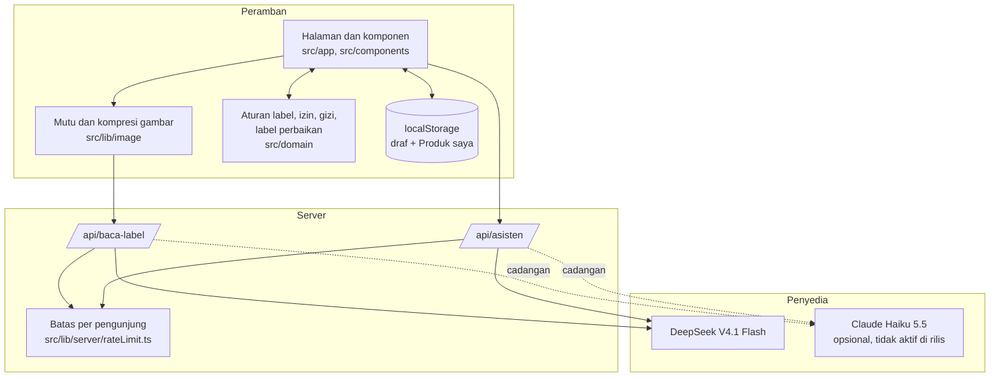

# Arsitektur

Tilik Label adalah satu aplikasi Next.js tanpa basis data dan tanpa akun. Server hanya punya dua tugas: meneruskan foto ke model pembaca, dan meneruskan pertanyaan ke asisten. Semua pemeriksaan aturan berjalan di peramban dari fungsi murni yang sama dengan yang diuji.

## Lapisan

Batas modul dijaga sesuai [CONTRIBUTING.md](../CONTRIBUTING.md): `src/domain/` tidak boleh memanggil jaringan, API luar, atau DOM.

## Halaman

| Rute | Isi | Jenis |
|---|---|---|
| `/` | Halaman depan | statis |
| `/periksa` | Alur empat langkah: foto, cocokkan isi, data produk, hasil | dinamis |
| `/juri` | Alur yang sama dengan tiga kemasan contoh dan isi cepat di tiap langkah | statis |
| `/contoh` | Hasil pemeriksaan ketiga contoh tanpa mengisi apa pun | statis |
| `/produk` | Daftar "Produk saya" dari perangkat | statis |
| `/aturan` | Aturan yang diperiksa, pasal, cara cek, dan batasan | statis |
| `/nilai-gizi` | Tiga jalan resmi menyiapkan tabel nilai gizi | statis |
| `/mcp` | Panduan koneksi server MCP, prompt inisialisasi agen, dan daftar tool/resource | statis |
| `/cetak` | Label perbaikan berskala fisik dan lembar ringkasan, untuk disimpan sebagai PDF | dinamis |

## Pembaca foto: `POST /api/baca-label`

1. **Di peramban**, `src/lib/image/quality.ts` menilai ketajaman dan terang gambar, lalu `prepareImage.ts` mengecilkannya ke sisi terpanjang 1600 px. Berkas yang diterima: JPEG, PNG, WebP.
2. **Di server**, route menolak permintaan peramban dari situs lain, membatasi badan permintaan sekitar 6,5 MB, dan mengecek kuota pengunjung.
3. `src/lib/server/labelReader.ts` mencoba penyedia sesuai `LLM_PROVIDER` (bawaan `deepseek`), lalu penyedia satunya bila gagal dan kuncinya terisi. Di situs rilis hanya kunci DeepSeek yang diisi. Keluaran diminta dalam skema JSON `EXTRACTION_JSON_SCHEMA`.
4. `validateExtraction` di `src/domain/labelExtraction.ts` memeriksa bentuk jawaban. Jawaban yang tidak sesuai ditolak, dan pengguna diarahkan mengisi sendiri (`arahan: 'isi_manual'`).
5. Gambar tidak disimpan. Respons selalu `Cache-Control: no-store`.

Ketepatan kedua penyedia bisa dibandingkan dengan `node scripts/bandingkan-pembaca.mjs` terhadap tiga label uji di `scripts/contoh-label/` beserta jawaban harapannya di `harapan.json`.

## Pembaca foto resep: `POST /api/baca-resep`

Alur dan pengamannya sama dengan `/api/baca-label` (kompresi di peramban, batas 6,5 MB, pengecekan asal permintaan, kuota `baca`, tanpa penyimpanan gambar). `src/lib/server/recipeReader.ts` meminta keluaran sesuai `RECIPE_EXTRACTION_JSON_SCHEMA` lalu memvalidasinya lewat `validateRecipeExtraction` di `src/domain/recipeExtraction.ts`. Satuan metrik/baku (g, kg, mg, ons, ml, liter) dikonversi ke gram/ml; satuan tidak baku (sdm, sdt, butir, secukupnya) dibiarkan kosong dengan catatan `takaranAsli` supaya pengguna yang melengkapi.

## Asisten: `POST /api/asisten`

- **Konteks terkunci.** `buildLockedContext` di `src/domain/assistant.ts` menyusun isian label, jawaban, dan hasil aturan; `buildReferenceMaterial` menyusun ringkasan pasal. Model menerima keduanya, bukan teks bebas dari pengguna saja.
- **Cakupan.** Pertanyaan di luar label pangan olahan dijawab dengan `OUT_OF_SCOPE_ANSWER`, yang mengarahkan ke Dinas Kesehatan atau teks resmi BPOM. Pertanyaan bebas dibatasi 200 karakter.
- **Pasal tidak bisa dikarang.** `checkAnswer` di `src/lib/server/assistant.ts` membuang jawaban yang menyebut pasal (`findUnknownArticles`) atau peraturan (`findUnknownRegulations`) di luar bahan acuan.
- **Status tidak bisa diubah.** Asisten hanya mengembalikan teks; status tiap aturan selalu dihitung ulang oleh `src/domain`.
- Batas waktu tiap panggilan 12 detik, dengan penyedia cadangan yang sama seperti pembaca foto.

## Server MCP: `POST /api/mcp`

Endpoint Model Context Protocol (MCP) Streamable HTTP tanpa status (`src/lib/server/mcpServer.ts` dan `src/app/api/mcp/route.ts`) agar agen AI luar (asisten desain, bot WhatsApp UMKM, atau pendamping UMKM) bisa memakai mesin aturan BPOM deterministik Tilik Label tanpa memanggil model LLM server dan tanpa akun.

- **Tool read-only:** `periksa_label`, `susun_label_perbaikan`, `cek_alergen_komposisi`, `daftar_aturan_bpom`.
- **Resource:** `bpom://aturan/katalog`, `bpom://aturan/batasan`, `bpom://contoh/kemasan`.
- Semua hasil menyertakan penafian *"pemeriksaan awal, bukan pengesahan"* dan daftar `pertanyaanBelumDijawab` bila fakta produksi masih perlu ditanyakan ke pemilik produk.

## Penyimpanan di perangkat

| Kunci `localStorage` | Isi | Kode |
|---|---|---|
| `tilik-label:draf-periksa:v1` | Draf alur periksa yang sedang berjalan, dipulihkan saat halaman dimuat ulang | `src/lib/periksaDraft.ts` |
| `tilik-label:produk-saya:v1` | Daftar produk dan status labelnya | `src/lib/produkSaya.ts` |

Semua akses lewat `src/lib/safeStorage.ts`, yang tetap aman saat penyimpanan diblokir (mode privat, kuota penuh). Pengguna diberi tahu bahwa data hilang bila data peramban dihapus.

## Pengaman layanan

`src/lib/server/rateLimit.ts` menghitung pemakaian per alamat IP (dari `x-vercel-forwarded-for`, `x-real-ip`, lalu `x-forwarded-for`) dan per server per hari.

| Variabel | Bawaan |
|---|---|
| `LLM_BATAS_BACA_PER_JAM` | 10 |
| `LLM_BATAS_BACA_PER_HARI` | 30 |
| `LLM_BATAS_ASISTEN_PER_JAM` | 20 |
| `LLM_BATAS_ASISTEN_PER_HARI` | 60 |
| `LLM_BATAS_HARIAN_SERVER` | 1000 |
| `LLM_BATAS_HARIAN_SERVER_ASISTEN` | 2000 |

Penghitungnya disimpan di memori proses, jadi di serverless tiap instans menghitung sendiri. Batas belanja di akun penyedia adalah pengaman terakhir.

## Label cetak

`src/domain/correctedLabel.ts` menyusun label perbaikan dari isian dan jawaban: menambah awalan baku ("Komposisi:", "Baik digunakan sebelum:"), menulis "P-IRT" dengan benar, menambah kalimat alergen resmi, dan membuang keterangan yang tidak boleh ada (misalnya "Halal" tanpa sertifikat). `canDownloadLabel` mengunci cetak selama butir wajib masih kosong. `src/domain/labelPrintScale.ts` menghitung ukuran huruf dari metrik font yang benar-benar dipakai (Atkinson Hyperlegible Next) supaya tinggi huruf kecilnya setara huruf "o" Arial 1 mm, dan 2 mm untuk nama produk serta peringatan alergen, sesuai Pasal 9.

## Mutu

| Pemeriksaan | Perintah | Di CI |
|---|---|---|
| Tes unit | `npm test` (26 berkas, 753 tes) | ya |
| Lint | `npm run lint` | ya |
| Tipe | `npm run typecheck` | ya |
| Build produksi | `npm run build` | ya |

Alur CI ada di `.github/workflows/ci.yml` dan berjalan di setiap PR dan push ke `main`.
